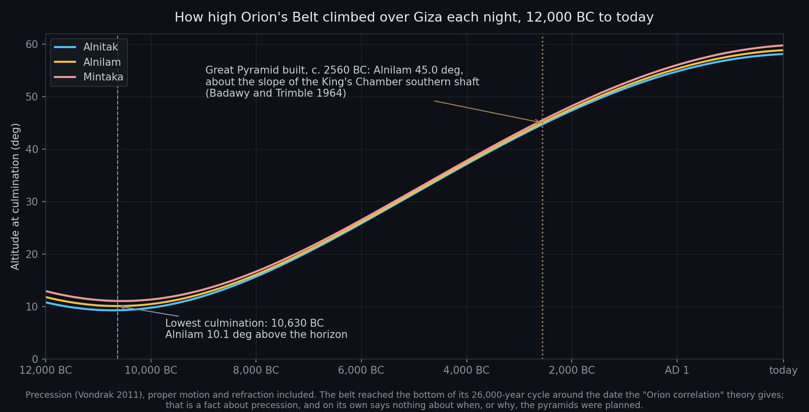
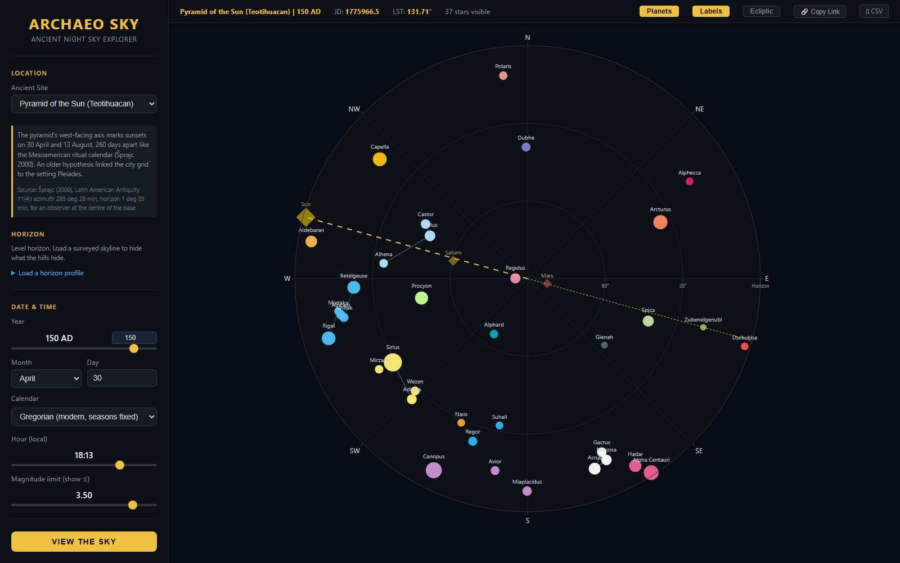

# Archaeo-Astronomy Sky Explorer

[](https://github.com/eduardobussien/Archaeo-astronomy/actions/workflows/tests.yml)
[](LICENSE)


**Tests claims that ancient monuments were aligned to the stars, by recomputing the sky over any site on any night from 12,000 BC to today with research-grade astronomy, checked against NASA JPL and the US Naval Observatory.**



*A claim, tested. The "Orion correlation" theory (Bauval and Gilbert 1994) ties the Giza pyramids to about 10,500 BC, when Orion's Belt stood at its lowest. The app confirms the astronomy (the lowest point fell around 10,600 BC) but shows that this is simply the bottom of a 26,000-year cycle that happens at some date for every star. The older proposal fits the pyramid's own era: in 2560 BC the Belt culminated at 45 degrees, about the slope of the King's Chamber's southern shaft. Made by [`scripts/orion_belt_figure.py`](scripts/orion_belt_figure.py).*

---

## What it does

- **Rebuilds the sky** over any place on Earth, at any local time from 12,000 BC to today: 60 bright stars, the Sun, Moon and planets, in an interactive chart.
- **Finds alignments.** Give it a monument's axis and it finds the years a star rose or set along it, or the days the Sun did, then jumps to that moment.
- **Answers calendar questions,** such as the first dawn Sirius became visible each year (its *heliacal rising*, which marked the Egyptian New Year).
- **Handles real landscapes.** Load a surveyed skyline and hills hide what is behind them; sunrise waits until the Sun clears them.
- **Shows its work.** Every answer is reproducible through a JSON and CSV API, every accuracy figure is held by an automated test (722 in all), and every source is cited.



*The web app reproducing a published result: on 30 April the Sun sets exactly along the axis of the Pyramid of the Sun at Teotihuacan (yellow line), as Šprajc (2000) found. Its other sunset date, 13 August, splits the year into 105 and 260 days, and 260 days is the length of the Mesoamerican ritual calendar.*

---

## How it works

Every claim about an ancient alignment comes down to one question: *where in that site's sky was this star on that night?* Answering it takes four steps.

1. **Start from a star catalogue.** Each star has a position on the sky (its *right ascension* and *declination*, the sky's version of longitude and latitude) measured in the year 2000, plus how fast it drifts across the sky (*proper motion*) and towards or away from us (*radial velocity*). The app moves each star along its path through space to the date asked for.

2. **Correct for precession.** The Earth's axis wobbles like a slowing spinning top, tracing a circle every 26,000 years. Over millennia that wobble moves every star relative to the poles and the equator: around 2800 BC the pole star was Thuban, not Polaris, and stars rose at points on the horizon several degrees from where they rise today. That is exactly the quantity alignment claims depend on, so precession is the heart of the engine. The standard formulas (IAU 2006) are fitted to a few centuries of observations and drift by a third of a degree by 10,500 BC. This app uses the long-term model of **Vondrák, Capitaine & Wallace (2011)**, valid for 200,000 years either side of today, through **ERFA**, the C library of the International Astronomical Union's official routines (the same one astropy uses).

3. **Turn the sky into the local view.** A coordinate transform rotates the star from the sky's frame into the observer's: how far it is around the horizon from north (*azimuth*) and how high above it (*altitude*). That rotation depends on the site's latitude and longitude and on how far the Earth has turned (the *Earth Rotation Angle*). One subtle term, the *CIO locator*, is usually taken from a series that diverges in deep time; the app integrates it from its definition instead, which keeps it correct to 0.1 arcminutes back to 4000 BC where the standard series is off by half a degree.

4. **Account for what an observer actually sees.** The air bends light near the horizon (*refraction*, about half a degree), the visible horizon may be raised by hills, and a star must climb high enough and the sky must be dark enough for it to be seen. Each of these is modelled from published research.

The Sun, Moon and planets follow the same last two steps, but first need the slowing of the Earth's rotation over the centuries (*Delta T*, about 16.6 hours by 2500 BC). The full technical account is in [docs/ENGINE.md](docs/ENGINE.md).

**How it is checked.** Stars are compared with astropy, an independent implementation; the Sun, Moon and planets with NASA JPL's DE441 ephemeris; sunrise and sunset times with the US Naval Observatory; and monument results with the publications they come from. Highlights from [docs/ACCURACY.md](docs/ACCURACY.md):

| Question | Accuracy |
|---|---|
| Where was a star at a given local time? | Within 0.7 arcminutes of astropy back to 1000 BC |
| What time was sunrise or sunset? | Within 33 seconds of the US Naval Observatory (it rounds to the minute) |
| Where were the Sun, Moon and planets? | Within 0.2 degrees of NASA JPL back to 3000 BC |
| On which days did the Sun set along Teotihuacan's axis? | The published dates exactly (30 April, 13 August) |

---

## Tech stack

- **Python 3.12**, **NumPy** (every calculation is vectorized: a whole year of sunrises or 14,000 years of a star's rising point in one pass)
- **pyerfa**, the Python binding of ERFA, for precession, Earth rotation and the solar system theories
- **Flask** for the web server and JSON/CSV API
- **Plotly.js** for the interactive sky chart, in a single-page front end with no build step
- **Matplotlib** for static figures and chart export
- **pytest**, with **astropy** as an independent reference; **GitHub Actions** runs the suite on Ubuntu and Windows on every push

---

## Quick start

Requires Python 3.12 and git.

```bash
git clone https://github.com/eduardobussien/Archaeo-astronomy.git
cd Archaeo-astronomy
python -m venv venv
```

Activate the environment. On Windows (PowerShell):

```bash
venv\Scripts\activate
```

(If PowerShell says running scripts is disabled, run `Set-ExecutionPolicy -Scope CurrentUser RemoteSigned` once, or use Command Prompt, where the same command works.)

On macOS or Linux:

```bash
source venv/bin/activate
```

Install the dependencies (pinned versions):

```bash
pip install -r requirements.txt
```

### Run the web app

```bash
python app.py
```

Then open http://127.0.0.1:5000, choose a site and press **View the Sky**. The **Try This** cards in the sidebar load ready-made examples.

### Run from the command line

A star table for a site and date, with any stars lined up on the monument's axis:

```bash
python src/alignment.py --monument Giza --year -2559 --month 3 --day 20 --hour 21.5
```

The same sky as a chart image:

```bash
python src/visualize.py --monument Giza --year -2559 --hour 21.5 --save giza_2560bc.png
```

Years use astronomical numbering, so `-2559` is 2560 BC (year 0 is 1 BC). `python src/alignment.py --list-monuments` lists the 13 sites.

### Run the tests

```bash
pip install -r requirements-dev.txt
python -m pytest
```

All 722 tests should pass in about 30 seconds.

---

## Example output

The command-line tool, at the Great Pyramid in 2560 BC (shortened):

```
=== Archaeo-Astronomy Alignment [Vondrák 2011] ===
Location : 29.9792, 31.1342
Date     : 2560 BC, 03-20
Time     : 21.50h  |  JD: 786483.31  |  LST: 140.06
--------------------------------------------------------------
STAR         | CONST          |      ALT |       AZ | STATUS
--------------------------------------------------------------
Alnitak      | Orion          | -24.28°   | 266.05°   | hidden
Thuban       | Draco          |  30.95°   |   1.12°   | VISIBLE
...

--- Alignment check vs 'Great Pyramid of Giza' (±2.0°) ---
  Thuban        az=  1.12°  (Δ=1.12°)  alt=+30.95°  [VISIBLE]
```

The pyramid faces true north, and the star nearest that axis is Thuban, the pole star of the pyramid age.

The API, asking when Sirius rose along the 165-degree axis of Göbekli Tepe (`GET /api/alignment?site=Göbekli Tepe&star=Sirius`, shortened):

```json
{
  "star": "Sirius", "event": "rise", "azimuth": 165.0, "found": true,
  "crossings": [
    {"year": -8812, "drift_deg_per_century": -1.508,
     "night": {"month": 8, "day": 4, "hour": 23.956, "azimuth": 165.002}}
  ]
}
```

Sirius rose on that axis in 8813 BC, within the site's period of use, while its rising point was moving 1.5 degrees along the horizon each century. All endpoints are documented in [docs/API.md](docs/API.md).

---

## Project structure

```
app.py                  Flask server: the web page and the JSON/CSV API
src/
  precession.py         Star positions: space motion, long-term precession, Earth rotation
  solar_system.py       Sun, Moon and planets from ERFA's analytic theories
  timescales.py         Delta T, the slowing of the Earth's rotation, and its uncertainty
  refraction.py         Atmospheric refraction, scaled by the site's elevation
  visibility.py         How dark the sky and how high a star must be for it to be seen
  horizon.py            Horizon profiles: the skyline's altitude in every direction
  alignment.py          The sky for a site and date, heliacal risings, calendars (also a CLI)
  alignment_finder.py   When a star or the Sun rose or set along an axis
  data.py               Star catalogue (60 stars) and monument list, with sources
  visualize.py          Static sky chart with Matplotlib (also a CLI)
templates/index.html    Single-page web interface (Plotly.js)
scripts/                Figure for this README
tests/                  722 tests; data/ holds the JPL and US Naval Observatory reference values
docs/                   Engine, accuracy, sources, API and a guide to investigating your own site
```

---

## Limitations

- **Bright stars only.** The catalogue holds 60 stars chosen for their place in ancient astronomy, so the chart shows stars down to magnitude 3.7 rather than the full naked-eye sky (about magnitude 6).
- **Mean positions.** Nutation and aberration, two small periodic shifts under 21 arcseconds each, are left out. That is far below what any alignment claim depends on, but the positions are not suitable for precision work.
- **Delta T before 720 BC is extrapolated.** Stars are unaffected, but the Moon's position at a given hour is uncertain by about a degree in 2500 BC and by several degrees in deep prehistory.
- **The Moon and outer planets drift in deep time.** The analytic theories are tuned to recent millennia, reaching 1 to 2 degrees of error by 10,000 BC.
- **Standard weather.** Refraction assumes standard conditions; real weather moves objects near the horizon by a few arcminutes.
- **Visibility is a model.** Heliacal rising dates carry the model's uncertainty of a few days, and the sky view counts a star as visible whenever it is above the horizon, even in daylight.
- **Some monument data is approximate.** The axes of Avebury, Carnac and Tiwanaku, and Machu Picchu's horizon, have no published survey behind them yet; the app marks them as approximate.
- **Horizon profiles are not yet in shareable links.** A loaded skyline must be pasted again after following a link.
- **Astronomy is not archaeology.** The app can show that a star rose on an axis in a given year; whether the builders intended it needs archaeological evidence and a check that the match is not chance (the [research guide](docs/RESEARCH_GUIDE.md) shows how easily chance matches occur).

---

## Roadmap

**Done**

- Long-term precession engine (Vondrák 2011 via ERFA), validated against astropy, JPL DE441 and the US Naval Observatory
- Interactive web interface and static chart export
- Alignment finder for stars and the Sun, heliacal risings, horizon profiles, CSV export and an API

**Next**

- **Expanded star catalogue:** the full naked-eye sky (about 9,000 stars from the Yale Bright Star Catalogue) instead of 60 stars
- **Visualization:** horizon profiles carried in shareable links, and a view along an axis as an observer on the site would see it
- **Interface:** a hosted public demo, and lunar standstill searches for sites claimed to follow the Moon
- **Data:** published surveys for the remaining approximate monument axes

---

## Documentation

- [docs/ENGINE.md](docs/ENGINE.md): how each part of the calculation works, in depth
- [docs/ACCURACY.md](docs/ACCURACY.md): how accurate each answer is, by era, and what it was checked against
- [docs/SOURCES.md](docs/SOURCES.md): every source behind the engine and the monument data, with its strength
- [docs/API.md](docs/API.md): endpoints, parameters and CSV output
- [docs/RESEARCH_GUIDE.md](docs/RESEARCH_GUIDE.md): investigating your own site, from measuring the axis to reporting a result

## License

[MIT](LICENSE)
